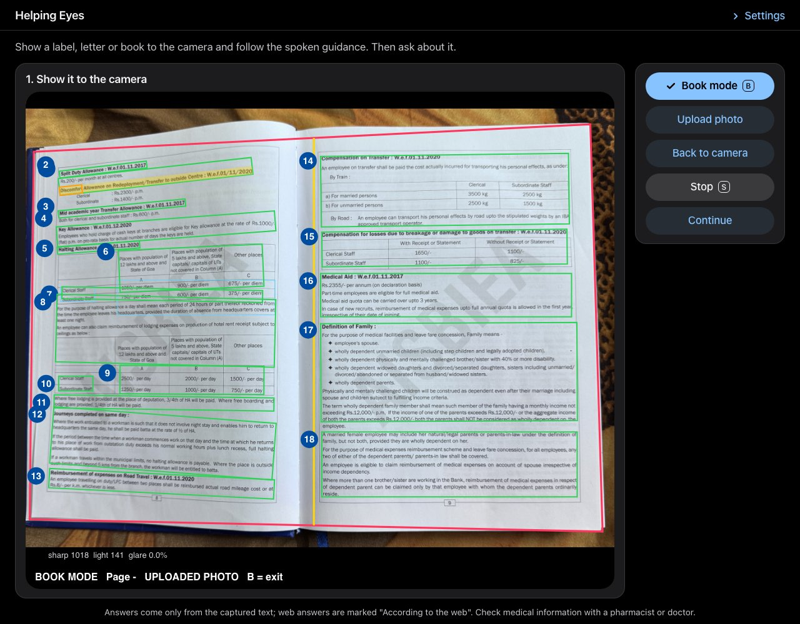
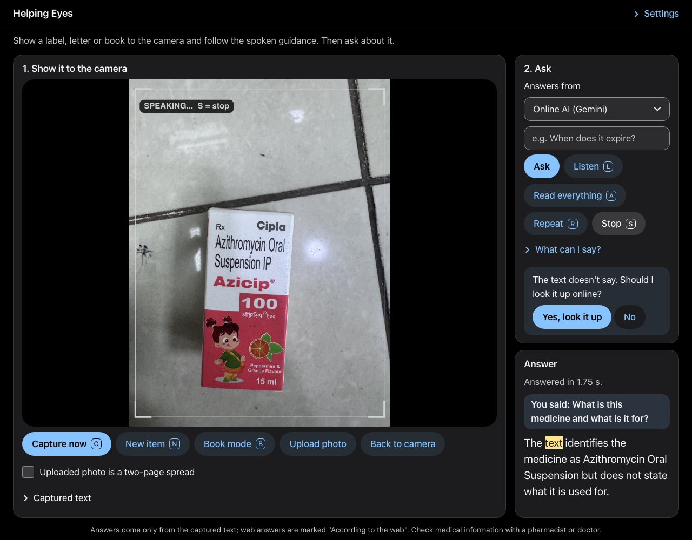
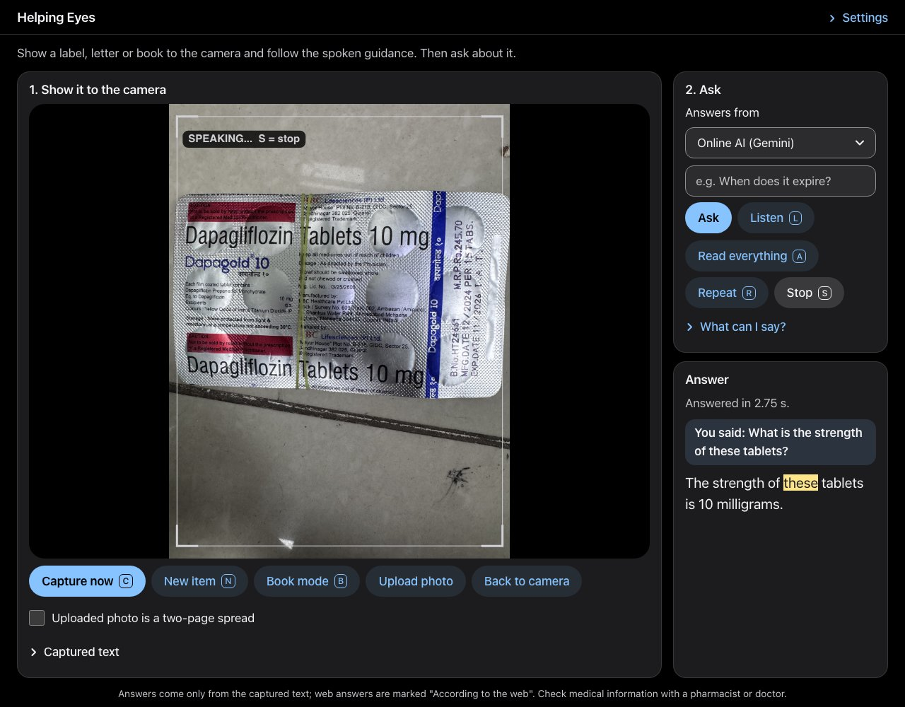
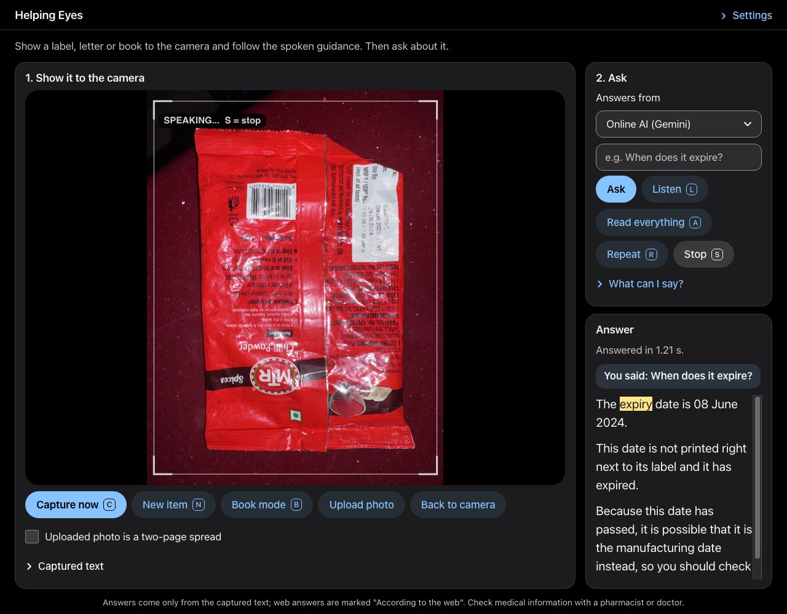
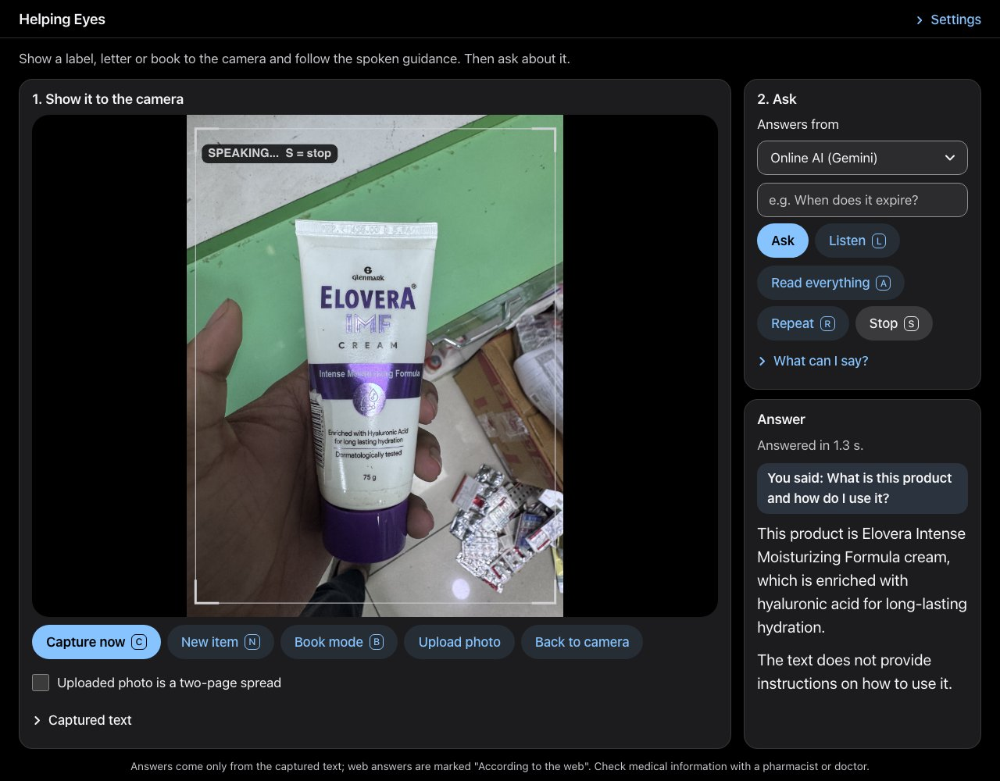
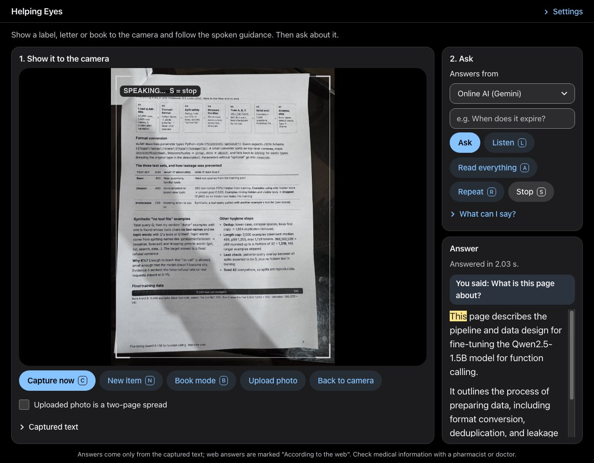
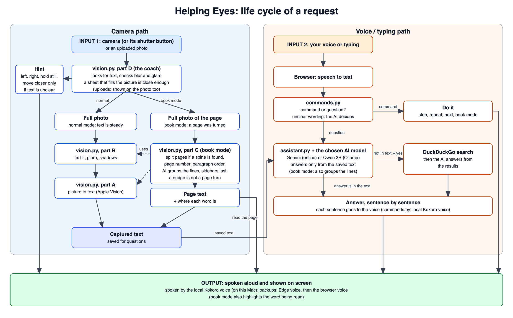

# Helping Eyes — Computer Vision-Based Document Reading System for the Visually Impaired

An assistive reading app for blind and low-vision people: show a medicine pack, a label, a letter or a book to the
camera, follow the spoken guidance, then ask about it aloud. It runs on a Mac and can be shared to a phone.

## Table of Contents

1. [Problem Statement](#problem-statement)
2. [Introduction](#introduction)
3. [Demo](#demo)
4. [Objectives](#objectives)
5. [How It Works](#how-it-works)
6. [Quick Start](#quick-start)
7. [Results at a Glance](#results-at-a-glance)
8. [Main Limitations](#main-limitations)
9. [Documentation](#documentation)
10. [References](#references)

---

## Problem Statement

Visually impaired individuals face significant barriers when accessing printed materials such as books, documents, medicine labels and signage. Existing assistive solutions have several limitations:

- **Cost:** most commercially available reading aids are expensive.
- **Dedicated hardware:** they require special-purpose devices rather than equipment people already own.
- **Low-light performance:** real-time reading in poor lighting remains difficult for traditional OCR systems.
- **Accuracy:** conventional OCR pipelines struggle with blur, complex backgrounds and varied fonts.
- **Information overload:** reading an entire label aloud forces the user to listen to everything to find the one detail they need.

Helping Eyes addresses these gaps with an affordable reading assistant that runs in an ordinary web browser, on any computer or phone with a camera, and answers the user's questions about what the camera sees.

---

## Introduction

**Helping Eyes** is one web application: a browser page owns the camera, microphone and speaker, and a Python server
on your Mac does the reading. Rather than reading everything aloud, it lets the user ask about the captured text and
returns only the information requested.

- **Live text detection** on pages, books, medicine packs, labels, signs and screens, with **spoken guidance**
  ("Move closer", "Glare on the right, tilt the page") until the text is in view, then automatic capture.
- **Spoken or typed requests:** *"Read everything"*, *"Read only the dosage"*, *"When does it expire?"*
- **Hands-free listening:** the microphone listens only while the app is quiet, so it never answers itself.
- **Answers** from Gemini Flash-Lite (any OpenAI-compatible API works) or from Qwen 2.5 3B on the Mac through Ollama,
  spoken sentence by sentence as they are generated.
- **A natural voice made on the Mac** (Kokoro), with the free Edge voice and then the browser's voice as backups.
  Serial and batch numbers are read digit by digit.
- **Optional web lookup** when the text does not hold the answer, only with the user's consent.
- **Book mode:** page-turn detection, two-page spread splitting, page numbers, reading order, the word being read
  highlighted, and misread words corrected by the language model.

Text recognition (Apple Vision) and layout analysis run on your Mac. Only the captured text (never the picture) is sent
to the language model, only the search words go to a web lookup, and the voice is made on the Mac.

---

## Demo

Real photos from the evaluation set, uploaded with **Upload photo** and asked about in the page (answers from Gemini, as
shown on screen, 11 November 2026). Each answer was checked against the photo.

**Book mode.** An open two-page spread: the red border is the book found in the picture, the yellow line is the spine,
the numbers are the reading order across both pages (columns, headings and tables kept in order), and the line being
read aloud is highlighted.



| Medicine box | Tablet strip |
|---|---|
|  |  |
| *"What is this medicine and what is it for?"* It is Azithromycin Oral Suspension; the label does not say what it is for, so the app offers to look it up online (only if you say yes). | *"What is the strength of these tablets?"* 10 milligrams. |
| **Food label** | **Personal care** |
|  |  |
| *"When does it expire?"* 08 June 2024, which has passed, so it has expired. The date is printed away from its label, and the app's own date check found it. | *"What is this product and how do I use it?"* Elovera Intense Moisturizing Formula cream with hyaluronic acid; the label gives no instructions, and the app says so instead of guessing. |
| **Document** | |
|  | |
| *"What is this page about?"* The pipeline and data design for fine-tuning Qwen2.5-1.5B for function calling, read through a hand's shadow. | |

---

## Objectives

- Detect text automatically from a live camera feed, on any object.
- Extract text accurately and quickly with Apple Vision, the text recognition built into macOS.
- Let the user request exactly the information they need instead of listening to everything.
- Answer questions only from the captured text, without inventing details.
- Read books page by page without manual interaction.
- Run on ordinary hardware: a Mac as the server (Apple Vision reads the text), any phone or computer with a browser as the camera, and a free language-model API key; no GPU and no paid service.

---

## How It Works



Camera pictures go through the live guide, the photo fixer and the text reader (`vision.py`) into saved text; a spoken
or typed request goes through speech to text and the command check (`commands.py`) to the language model
(`assistant.py`); everything comes back as speech and on-screen output. The parts, every file and the design of each
step are in **[markdown/design.md](markdown/design.md)**.

---

## Quick Start

On a Mac (Apple Vision is part of macOS):

```bash
python3 -m venv .venv && source .venv/bin/activate
python -m pip install -r requirements.txt
echo "LLM_API_KEY=<YOUR_KEY>" >> helping_eyes/.env     # free key from https://aistudio.google.com/apikey
python run.py                                           # checks the setup, starts the app and opens it in Chrome
```

Allow the camera and microphone when the browser asks. Optional extras:

```bash
python run.py --get-voice      # once: the local Kokoro voice (about 350 MB)
python run.py --share          # a public https address, for a phone
```

Settings, sharing with an access code, tests, the evaluation and troubleshooting are in
**[markdown/setup.md](markdown/setup.md)**. What to say and which buttons to press: **[markdown/usage.md](markdown/usage.md)**.

---

## Results at a Glance

Measured on 164 real photos and the real server on an M3 Pro MacBook; details in
**[markdown/performance.md](markdown/performance.md)**, full tables with 95 % intervals in
[markdown/eval/eval_results.md](markdown/eval/eval_results.md).

| What | Result |
|---|---|
| Key lines of text read right (the app's capture, Apple Vision) | **90.5 %**, 0.31 s a photo (Tesseract: 59.2 %) |
| Factual answers right (name, strength, dates, batch, price, maker) | **80.0 %** with Gemini Flash-Lite, 64.5 % with Qwen 2.5 3B |
| Says "the text doesn't say" when the photo really doesn't | 93.9 % with either model |
| "Has it expired?" decided by the app's date check | 22 / 22 |
| Capture of a label, median | 0.29 s |
| Question → start of the spoken answer, Qwen on the Mac, median | 1.37 s |
| Automated tests | 175, plus 17 for the evaluation's scoring rules |

---

## Main Limitations

- **Mac only:** text recognition uses Apple Vision, so the server cannot run on Linux or Windows.
- **Browser:** speech recognition needs Chrome or Edge; other browsers work with typed requests.
- **Recognition errors:** small, curved, reflective or blurred print may be misread, and answers can only be as
  accurate as the captured text. Check medically important information with a pharmacist or doctor.
- **Live checks** run about 5 times a second, below the 10 a second the requirements ask for.
- **Book mode** looks for the spine inside the book's border, so a book whose spine is away from the middle of its
  outline (one cover folded back) is split in the wrong place.

All of them: [markdown/performance.md](markdown/performance.md#known-limitations).

---

## Documentation

| Guide | What is in it |
|---|---|
| [markdown/setup.md](markdown/setup.md) | Requirements, settings, installation, running and sharing, tests, the evaluation, troubleshooting |
| [markdown/usage.md](markdown/usage.md) | Everything you can say or type, the buttons and keys |
| [markdown/direction.md](markdown/direction.md) | The short version: what each button does and what to say |
| [markdown/design.md](markdown/design.md) | Architecture, design of each part, every file, innovations |
| [markdown/book_mode.md](markdown/book_mode.md) | The computer vision of book mode and how it was tested |
| [markdown/computer_vision.md](markdown/computer_vision.md) | Every computer vision idea in the project, in simple words |
| [markdown/performance.md](markdown/performance.md) | Measured results and all known limitations |
| [markdown/working.md](markdown/working.md) | A plain-language tour of every file and of a request's life cycle |
| [markdown/eval/](markdown/eval/) | The evaluation plan, the photo shot list, the results and the full photo report |

---

## References

1. U. Gawande, N. Rathod, P. Bodkhe, P. Kolhe, H. Amlani and C. Thaokar, "Novel Machine Learning based Text-To-Speech Device for Visually Impaired People," *2023 2nd International Conference on Smart Technologies and Systems for Next Generation Computing (ICSTSN)*, Villupuram, India, 2023, pp. 1–5. doi: 10.1109/ICSTSN57873.2023.10151637

2. D. S R, V. K. Gowda, R. Rai R, S. Kumar S and V. K P, "Smart Reader for Blind People," *2025 International Conference in Advances in Power, Signal, and Information Technology (APSIT)*, Bhubaneswar, India, 2025, pp. 1–4. doi: 10.1109/APSIT63993.2025.11086193

3. A. Sharma, A. Srivastava, and A. Vashishth, "An Assistive Reading System for Visually Impaired using OCR and TTS," *International Journal of Computer Applications*, vol. 95, no. 2, pp. 13–18, Jun. 2014. doi: 10.5120/16566-6231

4. Apple Vision, `VNRecognizeTextRequest`. https://developer.apple.com/documentation/vision/vnrecognizetextrequest
