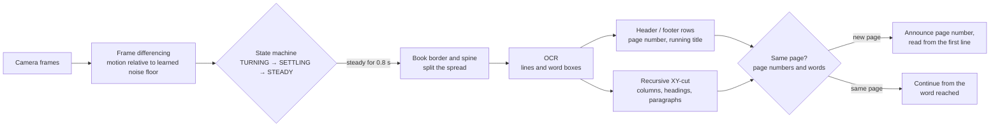

# Book reading mode

The computer vision of book mode, step by step, and how it was tested. The full explanation of every idea is in [computer_vision.md](computer_vision.md). Back to the [README](../README.md).

## Computer Vision: Book Reading Mode

Book mode reads a book page by page without manual interaction: the user opens the book in front of the camera, listens, and turns the page. The OCR engine recognises the characters of each line; **the decisions of when to read, where each page lies and in what order to read are made by the project's own OpenCV pipeline** in [`vision.py`](../helping_eyes/vision.py) (parts C and D).

On screen, book mode draws the book's border (red, its four sides following its tilt), the spine (yellow), the printed page numbers and running title (purple, announced but not read in the text flow) and the paragraphs (green), numbered in reading order; the status bar shows the recognised page numbers.

### 1. Page-turn detection: frame differencing and a state machine

- Each frame is reduced to 320×180, converted to grayscale and blurred. The **mean absolute difference** from the previous frame measures motion, and a **median over the last five frames** suppresses isolated noisy frames.
- The detector **learns the camera's noise floor** (a running average of motion while the scene is still) and sets its movement and stillness thresholds relative to it, making it robust across cameras and lighting conditions.
- A state machine (`TURNING` → `SETTLING` → `STEADY`) reports an event once the view has been still for 0.8 s after movement.
- **Layout fingerprint:** an 80×45 binary image of the page layout (adaptive threshold with horizontal dilation, so that each text line forms a band) distinguishes a clearly different layout (`changed`) from the same layout after movement (`moved`). Because dense book pages have almost identical layouts, a `moved` event is still checked against the page's words and printed page number (section 5) rather than being ignored.
- **Vibration and nudges:** the fingerprints are compared after sliding one over the other by up to 4 cells (and a light blur), so a book that shifted or vibrated slightly is still the same page; a different page differs at every alignment (measured: 0.01 for a shifted page, 0.28 for a different one, against a threshold of 0.06). When the layout looks the same (`moved`) but the OCR words are too garbled to line up (a blurred frame), `BookReader` still keeps reading (`MOVED_SAME_PAGE`) and never restarts the page from the first word.

### 2. Two-page spread splitting: spine detection

- **The book's border (`find_book_quad()`):** the whole frame is read once, then the open book's outline is found as four corners that follow its tilt. Apple's own document detector is asked first (`VNDetectDocumentSegmentationRequest`, the one the Files and Notes scanners use; `apple_document_quad()`). It is used only when its outline is a proper four-sided shape (every corner 60° to 120°; when unsure it can return a sliver) that holds at least 90 % of the book's text, so an outline round one page of a spread is never taken. Otherwise the outline is grown from the text of both pages with GrabCut (`find_item_quad(..., every_piece=True)`: both halves count, though the fold can cut the paper in two). Text lines up to 30 % of the picture apart count as one book, so even an index page with a wide blank before the facing page belongs to it. A light or patterned surface under the book is therefore never taken for paper, as a brightness threshold does (`find_book()`, which is now used only when no border is found). A tilted book is flattened by its own four corners before the pages are split.
- **Spread or single page:** a border at least 1.1 times wider than tall is a two-page spread; a single page is not split.
- **Shadow cue:** a partially opened book casts a shadow along the spine, visible as a **dark valley** in the column-wise mean brightness. When the valley is at least 12% darker than both pages, the spread is split there.
- **Text-free strip cue:** a fully opened book casts little or no shadow, and the spine region is often the brightest part of the image. Because text never crosses the spine, the two inner margins form the **smoothest vertical strip** of the book. Texture is measured as the **local standard deviation of brightness** per column (text remains textured even when slightly blurred, blank paper does not), and the smooth strip nearest the centre of the book is selected. The strip must be at least 7% of the book's width, which is wider than the gap between two columns of one page.
- **Both cues are looked for inside the border** and need both sides of the spine to hold a real block of text (at least a fifth of the book's width each). **When neither is found, the spine is the centre of the border** (`find_spine()`): the spine of an open book is nearly always there. Without a border (no book outline found) only the cues count, as before, and a page with two columns, a blank sheet or a picture where only one side has text is read as one page.
- **On screen:** the border's four sides are drawn in red and the spine in yellow, as a line from the border's top side to its bottom side that leans with the book.

### 3. Page structure and reading order

The page structure is derived from the boxes of the lines the OCR recognised, which are reliable whenever the text is readable, even on camera frames that are slightly blurred.

- **Rows:** lines that overlap vertically are grouped into rows (for example, a page number and a running title on the same header line).
- **Header and footer:** the first and last rows are treated as a header or footer when they are separated from the body by a gap clearly larger than the usual line spacing and are either short or contain a page number. They are **announced, not read in the text flow**.
- **Printed page number:** recognised in the header or footer in the forms `47`, `- 47 -`, `Page 47`, `xii` (Roman numerals), `47  THE SILENT RIVER` and `CHAPTER THREE  48`. On a two-page spread, a number missing on one page is inferred from the facing page. A new page is announced as *"Page 47"* or *"Pages 46 and 47"*; when no number is printed, no number is announced.
- **Running title:** the remaining header or footer text (book or chapter title) is announced when it changes.
- **Headings:** lines set in noticeably larger type, or beginning with words such as *Chapter*, *Part* or *Prologue*, are recorded and read at their position in the text.
- **Reading order, recursive XY-cut:** a classic document layout algorithm applied to the line boxes. A region is split at the widest vertical gap between line boxes that is wider than a column gap (columns, read left first); otherwise at a horizontal gap clearly larger than the usual line spacing (headings, paragraph breaks, read top first); the parts are processed recursively. A region that cannot be split is read line by line, and an **indented first line** starts a new paragraph. Words hyphenated across lines are rejoined. **Paragraphs by the language model:** these heuristics cannot tell a sentence that continues in the next column or page from a new paragraph, and every false paragraph is a pause. A sidebar, box or caption beside the main text is worse: its rows are level with the main text's rows, so the reading order alternates between the two. So before a page is spoken, `line_blocks()` groups the lines into blocks from their boxes alone (lines stacked under each other with the same left edge and span: a column, a heading, a sidebar each become a block), and the numbered lines, listed block by block with their position, letter size and layout tags (`[page]`, `[column]`, `[gap]`, `[indent]`, `[short]`), go to the model (`DocAssistant.arrange_lines()`, `ARRANGE_PROMPT` in `assistant.py`), which returns only a grouping and an order, as JSON: the paragraphs in reading order (the main text of a page first, then its sidebars; a sentence that runs from one block into another is joined), each a list of line numbers, plus lines to leave out (page numbers, stray fragments). The code rebuilds the page text from the original lines, so no word is ever changed and the highlight keeps working. A reply that loses or repeats a line, skips more than a quarter of the page, is slow (12 s limit) or fails is ignored, and the page is read with the heuristic paragraphs. This adds about 2 to 3 seconds before a new page starts; the same page is not sent twice.
- The page facts (page numbers, running title, headings) are also passed to the language model, so questions such as *"What page is this?"* or *"Which chapter is this?"* can be answered.

### 4. Reading position highlight

While a page is read aloud, the display follows the speech word by word: the **line being spoken is highlighted** (yellow) and the **word being spoken is outlined** (orange).

- **Spoken position:** `app.js` estimates the word being spoken from how far through the audio it is (the server gives no word times; the browser fallback voice reports the word through the `boundary` event of `speechSynthesis`) and converts it to a character position in the page text. The server splits the page into paragraphs (`speech_chunks()` in `vision.py`), and each is spoken separately, so the start-up delay coincides with the natural pause between paragraphs. Voices that send no word events still advance the position paragraph by paragraph.
- **On-page location:** during recognition, the OCR engine provides a bounding box for every word, and `read_page()` records which characters of the page text belong to which printed line and word (`PageLayout.lines`). The server sends this layout to the page with each new book page.
- Combining the two yields the exact on-screen location of the word being spoken, drawn on the overlay in the browser.

### 5. Continuing after the view moves

If the camera or the book moves, the new view is compared with the page being read before anything is spoken again (`continue_from()` in `vision.py`):

- The words of both views are aligned with a sequence matcher (`difflib.SequenceMatcher`). Only matching runs of at least three consecutive words count, so common words shared by different pages do not register as an overlap.
- **Printed page numbers take precedence:** if both views show page numbers and they differ, the view is a new page regardless of the words.
- **Same words in view:** reading continues from the exact word it had reached, without announcing a new page or repeating anything. If the book was only slightly disturbed (for example, a hand passed over the page) while reading, speech continues without interruption. If the camera moved so that new lines came into view, those are read after the part already covered.
- **Different words:** the view is treated as a new page and read from the beginning.
- While the view is steady, the page layout is still re-checked once per second, so a slow drift of the camera or book is also noticed.
- The conversation about the page is kept when the view merely moves, so follow-up questions still work.

### Evaluation

| Test | Result |
|---|---|
| Spine detection, spread with a shadow (synthetic) | Exact (x = 960 of 1920; 640 of 1280) |
| Spine detection, fully opened book captured with the USB camera (no shadow) | x = 645, within the blank strip between the pages (approximately 570–665) |
| Spine detection, flat spreads without a shadow (synthetic) | Within the blank strip between the pages |
| Single portrait page | Correctly not split |
| Page structure, 6 synthetic layouts (spreads with header page numbers, chapter heading, hidden page number; single pages with footer number, header and heading, two columns) | 6/6: correct printed page numbers (including one inferred from the facing page), running titles and headings; reading starts at the first body line; page numbers are not read in the text flow |
| Paragraphs marked only by first-line indentation (novel style) | 5 / 5 found |
| Opening a random spread, then turning two pages (pages with near-identical layouts) | Announced "Pages 146 and 147", then "Pages 148 and 149", then "Pages 150 and 151"; the running title was announced once; the chapter heading was read at its position |
| Page-turn sequences (still page, hand passing over, page turned, new page), 10 random noise seeds | 10/10 correct: first page read after about 0.9 s of stillness, no re-read when a hand passes over, new page read about 1 s after the turn |
| Words mapped to their on-screen box (two-page spread) | 169 / 169 |
| View moved mid-read (camera shifted 320 px; top lines left, new lines entered) | Reading continued from the exact word reached, with no new-page announcement; the newly visible lines were then read |
| Different page after reading | Detected as a new page and read from the beginning |
| Real book, 5 phone photos (4 two-page spreads) | Reading order right for 98 % of line pairs; the spine was not found on any spread, so no printed page number was announced (0 / 5). See [Performance](performance.md#book-mode-on-a-real-book) |
| Real page-turn video (30 s, 4 turns) | Every new page read once, plus one early read while the hand was still turning |
| Processing time | Page-turn detector 0.2 ms per frame; spine and layout analysis 8 ms; full page including recognition and word boxes about 0.4–0.9 s, plus about 0.3 s for the whole-frame read that finds the book's border (0.74–1.22 s on the 5 real book photos) |
| Automated tests | 175 tests: reading text (10, real Apple Vision on rendered text), image quality and page geometry (12, including the item outline on a strip lighter or darker than the floor and with text in the background), book mode (36: page numbers, header and footer, reading order, spine, the book's border on a patterned cloth and its centre as the spine, page turns, resuming), live guidance and book-page decisions (33, including how much of the picture an item on a light floor fills, and the model's corrections of misread lines), commands and the voice (16, including dropping speech nobody waits for), language-model client against a fake provider, including expiry dates in common label wordings such as `Exp. Date 02/2027`, dates printed away from their label, and the model's paragraphs and line corrections (19), server endpoints and WebSocket with real OCR, and the access code (14), `run.py` (14: helpers, the key reaching the server, a real start, port fallback, Ctrl+C stop), the page's listening, start-up, voice, keyboard shortcuts and book-mode layout, zoom and Continue in headless Chrome with a fake speech engine (21; skipped without Chrome). The evaluation's scoring rules have 17 tests of their own (`eval/test_scoring.py`) |
| End to end in Chrome, fake camera filming a medicine label | Guidance, automatic capture (0.6 s), "read everything" and the expiry answer worked; in book mode with a looping two-page video, page turns were detected, announced and read (each page request 0.24–0.41 s). The language model itself was tested against a fake provider, not the real Gemini service |

The principal benefits of book mode are hands-free page turning, identification of the printed page number and title on any page, correct handling of two-page spreads and headers, paragraph structure, and the reading position highlight.
