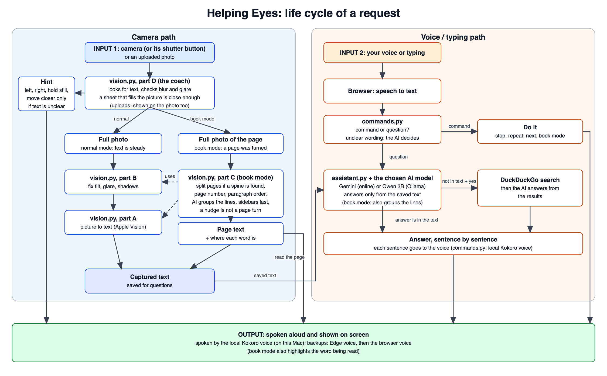
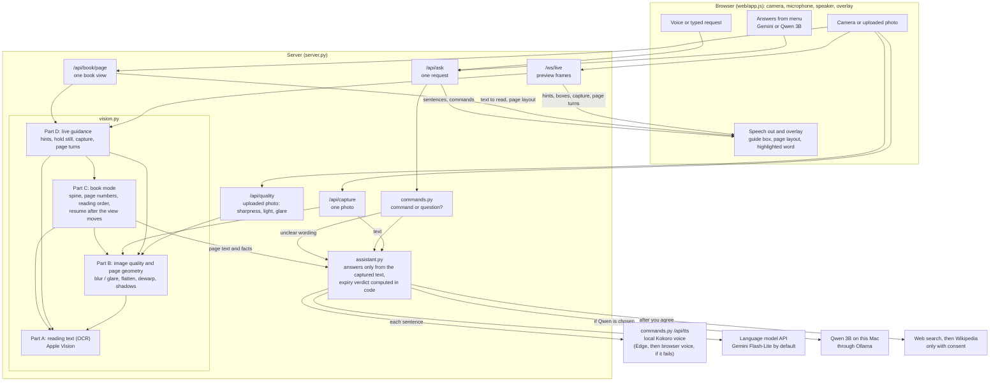

# Design of Helping Eyes

How the app is built: the life cycle of a request, the design of each part, every file, and what is new in it. Back to the [README](../README.md).

## System Architecture



The picture shows the life cycle of one request, from input to output. The diagram below shows the parts it passes through and how they connect.



---

## Design Approach

### Software Design

| Stage | Component | Description |
|---|---|---|
| Image acquisition | Browser camera (`getUserMedia`) | Rear camera at up to 1080p; small preview frames go to the server over a WebSocket, the full-size photo only when capturing |
| Text detection | Apple Vision (`vision.py`, part A) | Locates every line of text in each preview frame |
| User guidance | `vision.py`, part D (`LiveGuide`) | Spoken positioning hints, blur / glare coaching (every warning that applies, said one after another, and again every 5 s while needed), then a short hold-still countdown and automatic capture |
| Capture | OCR engine, accurate mode | Recognises all text once and stores it; nothing is read aloud yet |
| Voice input | Browser `SpeechRecognition` | Converts spoken requests to text, hands-free; the page also accepts typed requests |
| Request routing | `commands.py` | Decides whether a request is a command (stop, next, book mode, yes / no, search) or a question; the browser has no command logic of its own. Clear wordings are matched directly; unclear ones that mention the web, searching or looking up (or that answer the "look it up online?" offer) are read by the chosen language model, so any wording that means "look it up" works |
| Understanding | Language model API (Gemini Flash-Lite by default, or Qwen 2.5 3B on this Mac through Ollama, chosen in the page's **Answers from** menu; `assistant.py`) | Reads requested parts or answers questions using only the captured text. If the model answers "busy" (HTTP 429 or 5xx, as Google's free tier often does) or has not started answering within 8 s, the next model of `LLM_FALLBACK_MODELS` is asked, and the busy one is tried last for 5 minutes |
| Expiry checks | `assistant.py` | Expiry dates are compared with the current date in code, not by the model. A date printed right after an expiry label is certain (`expiry_dates`); on packs whose labels and dates are printed in separate columns, every printed date gets its own check (`printed_dates`): Gemini picks the expiry date from the text, with the rule that it is the latest date (it comes after manufacture); the small local Qwen model is given the latest date by the code and only words it. If the date taken has already passed, the answer adds that it may be the manufacturing date |
| Web lookup | Search engines through `ddgs` (Yahoo, Startpage, DuckDuckGo, then its own choice: `SEARCH_BACKENDS`), else Wikipedia's search API, and the language model | Used only with the user's consent; answers are prefixed with "According to the web". Each engine is tried in turn because they block scraping on and off; Wikipedia's API is not scraped, so it still answers when they all find nothing |
| Image quality | OpenCV layer (`vision.py`, part B) | Blur, glare and exposure scoring with spoken coaching; item outline grown from its own text (GrabCut, so a pack lighter or darker than the table is found alike) and homography flattening; curved-line dewarping; shadow removal and CLAHE when quality is low |
| Book reading | OpenCV pipeline (`vision.py`, parts C and D) | Page-turn detection, spread splitting, layout analysis, reading order, resuming after the view moves |
| Text-to-speech | Kokoro-82M on this Mac (`kokoro-onnx`, in `commands.py`, `POST /api/tts`), then the Edge neural voice (`edge-tts`), then the browser `speechSynthesis` | Each sentence is turned into MP3 audio, first by the local Kokoro voice (default `af_sarah`, American female; settings `TTS_ENGINE`, `KOKORO_VOICE`, `KOKORO_SPEED`, `KOKORO_MODEL_DIR`; about 5 times faster than real time on an M3 Pro CPU; the model is loaded and warmed up at start, and the audio is encoded with `lameenc`). Set it up once with `python run.py --get-voice` (about 350 MB, kept in `helping_eyes/voice_models/`, not in git). If it is not set up or it fails, the free Microsoft Edge neural voice (default `en-US-JennyNeural`, female; settings `TTS_VOICE`, `TTS_RATE`, `TTS_ENABLED`) speaks instead: no account, key or card. `/api/health` shows which one is first (`tts_engine`). The next few sentences are made while one plays; because the local voice is computer work and not a network call, the page waits 15 s (not 3 s) before sending a second request. A text longer than 300 characters (700 for the Edge voice; a book page is voiced in pieces of that size too) is cut at sentence ends, commas or spaces into pieces that are voiced one by one and joined, so nothing is dropped. A request that never answers does not stall the voice: if the first is not back after 3 s (or has failed) a second is sent and the first to arrive wins (everything is given up after 12 s, or 30 s for the local voice), and the server itself retries a hung call to the voice service once, with a short limit. If both fail, the browser's own voice speaks that one sentence; only after 3 sentences in a row fail is the browser voice used for 20 seconds before the server voice is tried again. The local voice makes one piece at a time, so a request that is still waiting when the page stops talking (Stop, a new item or page; each request carries a number that goes up then) or after the page's 30 s limit is dropped instead of made, and a second copy of a request uses the audio of the first: without this, abandoned sentences piled up and every new one waited 30 to 50 s. A request that takes over 5 s is logged as `TTS was slow`. The espeak phonemizer's harmless `words count mismatch` warnings are not logged. Numbers above 9999 (serial, batch and phone numbers) are spoken digit by digit. Queued and interruptible; the spoken word is estimated from the playing time for the on-screen highlight |

---

## Project Structure

```
Helping_Eyes-main/
├── helping_eyes/           # The application: server, vision, commands, assistant and the web page
│   ├── server.py           # FastAPI server: live stream, capture, book pages, requests, health; serves the page with no-cache headers
│   ├── vision.py           # All the computer vision in four parts: A reading text (OCR), B image quality, C book mode, D live guidance
│   ├── commands.py         # What a spoken or typed request means, and the spoken voice (local Kokoro, Edge as backup)
│   ├── assistant.py        # Question answering through a language model API, expiry checks, web lookup, book paragraphs and corrections of misread lines
│   ├── voice_models/       # The Kokoro voice model files (python run.py --get-voice downloads them; not in git)
│   ├── web/                # The page: index.html (with the round shutter button on the camera picture), login.html (the access-code page), app.js (camera, uploads, speech, overlay), style.css (light and dark themes with measured contrast, thick focus ring, reduced-motion / more-contrast / forced-colors support; fits a laptop screen with no scrolling, the camera taking three quarters of the width and Ask and Answer the last quarter; book mode shows only the camera, with Book mode, Upload photo, Stop and Continue beside it, and zooms the view in on the book once a page is read)
│   ├── tests/              # one test file per part of vision.py (ocr, quality, book, live), plus commands, llm, server, run and web_mic
│   └── .env                # Your settings: the key and optional choices (git-ignored, never committed)
├── markdown/               # Every guide other than the README:
│   ├── working.md          #   plain-language explanation of every file and of a request's life cycle
│   ├── setup.md            #   requirements, settings, installation, running, sharing, tests, troubleshooting
│   ├── usage.md            #   everything you can say or type, the buttons and keys
│   ├── design.md           #   this guide: architecture, design, every file, innovations
│   ├── book_mode.md        #   the computer vision of book mode and how it was tested
│   ├── performance.md      #   measured results and known limitations
│   ├── direction.md        #   what each button does and what you can say or type
│   ├── computer_vision.md  #   every computer vision idea of the project (pixels, maths, each step) in simple words
│   └── eval/               #   everything about the evaluation:
│       ├── eval_plan.md        # the real-world evaluation plan (OCR, answers, speed)
│       ├── eval_shotlist.md    # which photos to take for the evaluation, and how to import them
│       ├── eval_results.md     # every evaluation result against the requirement targets (generated by eval/make_results.py)
│       ├── eval_photo_summary.md  # results of the photo evaluation (numbers only; generated)
│       └── eval_photo_report.md   # every photo with its boxes, OCR text and all answers (generated; not in git)
├── eval/                   # The evaluation: tools/ (photo intake, folder import, photo checks), run_photo_eval.py (OCR engines, image checks drawn as boxes, every question to the local model), photo_report.py (scores and report), make_check_folders.py (one folder of photos per image check), run_qa.py (Gemini vs Qwen, web lookup safety, blind judging sample), run_expiry.py (expiry verdicts, with the model-alone ablation), run_latency.py (speed of the real server), run_book.py (book photos and a page-turn video), make_results.py (writes markdown/eval/eval_results.md), common.py (shared helpers, fixed evaluation date), test_scoring.py (checks of the scoring rules); results/ holds the numbers; data/private/ (photos and their text) is not in git
├── presentation/           # Slides, narrated video, script and the course requirements document
├── .github/workflows/      # check.yml: runs the tests on every push
├── run.py                  # Runs the whole app on this computer: checks, starts the server, opens Chrome
├── requirements.txt        # The only requirements file: every dependency (app, tests and evaluation)
├── architecture.png        # The life-cycle diagram shown under System Architecture
├── demo/                   # The screenshots shown under Demo (real photos uploaded into the page)
└── README.md               # The front page: overview, demo, quick start, main results, links to the guides
```

| File | Main components |
|---|---|
| `server.py` | `/ws/live` (preview frames in, guidance and page turns out) · `/api/capture` (photo → text) · `/api/quality` (uploaded photo → sharpness, light, glare, text boxes) · `/api/book/page` (book view → what to read, from where, and the page layout) · `/api/ask` (one request → commands, answers, web lookup, streamed as NDJSON) · `/api/tts` (one sentence → MP3 audio, with its own rate limit) · `/api/health` (status, key configured, OCR ready, memory, voice on) · `/login` and the access-code check (`ACCESS_CODE`: nothing but the sign-in page and the health check works until the code is entered; remembered for 30 days in an HttpOnly cookie derived from the code; 5 wrong codes a minute per visitor) · one session per browser (30 min) and a per-client rate limit |
| `vision.py` | **Part A, reading text (OCR):** `find_text_region()` for live detection · `recognize_text()` for full recognition, including per-word boxes · `read_text_enhanced()` tries corrected versions of a poor frame and keeps the best read · **Part B, image quality and page geometry:** `assess_quality()` (variance of the Laplacian, saturated glare blobs, exposure) · `find_page_quad()` and `warp_page()` (the item outline: grown from the text lines with GrabCut by `find_item_quad()`, or for a book page not yet read the bright paper region; `approxPolyDP`, homography) · `page_fill()` (how much of the picture the item fills, from the same item mask) · `estimate_dewarp()` and `dewarp()` (per-column vertical shift model for curved lines) · `enhance_tone()` (shadow removal, CLAHE) · `binarize()`. Set `VISION_ENHANCE=0` to disable; `BLUR_MIN` tunes the blur threshold · **Part C, book mode:** `PageTurnDetector` (frame differencing state machine) · `estimate_skew()` and `rotate_expand()` (a slanted page is straightened before the layout analysis; every line, word, paragraph and column keeps an outline that follows the slant, so the boxes on screen lie along the text) · `find_book_quad()` (the book's border: Apple's document detector `apple_document_quad()`, else grown from both pages' text) · `find_spine()` and `split_spread()` (the spine: its shadow or blank strip inside the border, else the border's centre) · `split_page_parts()` and `parse_page_number()` (header, footer, printed page number, running title) · `xy_cut()` (reading order) · `read_page()` · `arrange_page()`, `regroup()`, `line_hints()` (the model's paragraphs, built on the original lines) · `continue_from()` (compares a moved view with the page being read) · **Part D, live guidance:** `LiveGuide` (guidance hints, hold-still timing, quality coaching, capture trigger and re-arming) · `BookWatcher` (page turns on the live frames) · `BookReader` (new page, resume from the word reached, keep reading, nothing new) · `speech_chunks()` (page split into paragraphs for tracked speech) |
| `commands.py` | `classify()` (with an optional language-model `judge` for unclear wording) turns a request into stop, repeat, new capture, book mode on / off, yes / no (only while an offer is open), search, read everything or a question · the voice: `synthesize()` turns one sentence into MP3 with the local Kokoro voice (`kokoro-onnx`), or the free Edge neural voice (`edge-tts`) if Kokoro is not set up or fails, `spoken_form()` spells out numbers above 9999 digit by digit, and a small cache avoids repeating work |
| `assistant.py` | `DocAssistant.set_document()` and `ask()` stream answers sentence by sentence from any OpenAI-compatible chat API (`set_provider()` picks Gemini or the local Qwen 3B per request) · `judge_intent()` reads unclear yes / no / search wording · `ask_web()` searches and answers from the results · `wants_read_all()` detects full read-out requests · `expiry_checks()` determines whether expiry dates have passed · `web_lookup_allowed()` excludes item-specific questions such as expiry, batch and price |
| `web/app.js` | Camera and frame streaming · overlay (guide box, page layout, reading highlight) · speech output (plays the server's audio, prefetches the next sentences, estimates the spoken word for the highlight, falls back to the browser voice sentence by sentence; a sound that stops moving is nudged twice, then the browser voice says the rest of that piece from where it stopped, so nothing is skipped; every timer belongs to its sentence and is cleared when speech stops; on a phone the sound is unlocked at the first real tap, and a sentence the phone blocks waits for the next tap without freezing the camera guidance or the microphone (the start-up greeting is simply dropped); console lines `Voice: N characters ready in X ms`, `Server voice failed` and `Voice stalled at …` show where a pause comes from) · asks for the camera and the microphone in ONE request as soon as the page opens (one permission question; the microphone is released at once, and without a microphone the camera alone starts) · hands-free speech input with an echo guard, phone-safe results (a result that repeats the phrase so far replaces the previous one) and a 0.5 s pause before reopening the microphone on a phone, the words heard so far shown as "You said: ..." and spoken explanations when the microphone or the speech service fails · Settings (the screen reader reads everything instead of the app voice, through one live region; single-key shortcuts on / off) · the spoken word highlighted with the CSS Custom Highlight API, so the text is never rewritten · problems said aloud (camera blocked, server unreachable, live connection lost and back) · uploaded photos (shown in place of the camera with the same overlay, glare marker and book-mode reading highlight; New item returns to the camera) · Capture in book mode (the photo of the page stays on the screen, camera off, while it is read; once it has been read to the end, not stopped part-way, the camera comes back with the page kept as read, so the same page in view is nothing new and a turned page is read; no text closes it at once) · New item in book mode (forgets the page, sends the WebSocket `mode` message so the server forgets it too and reads the next steady view, and drops a page read still on its way; "next" by voice still means the next page) · the Answers from menu · the book-mode layout (only the camera, and the Book mode, New item, Upload photo, Back to camera and Stop buttons moved into a panel beside it, above Continue, which reads the rest of the page from the sentence where reading was stopped; the full page comes back in normal mode) · the book-mode zoom (once a page is read, the book's border from the server, or else its text, is enlarged to fill the camera view with a CSS transform, the rest is masked and the overlay is drawn in the same enlarged coordinates; the frames sent to the server are always the whole picture) · keyboard shortcuts (never while typing or choosing in the menu). It holds no decision logic |

---

## Innovations

### 1. Question-driven reading
A medicine package can contain hundreds of words. Instead of reading everything aloud, the user asks for the specific information needed — the dosage, the expiry date or a warning — and receives a short spoken answer.

### 2. Text detection instead of object detection
Helping Eyes detects text directly rather than specific object categories, so any item with readable text — a page, a medicine strip, a food package, a sign or a screen — can be captured.

### 3. Grounded answers
The model is instructed to use only the captured text and to state when the answer is not present, and expiry dates are evaluated in code rather than by the model (the model is told the verdict and words the answer itself). When the date is not printed next to its label, the code checks every date on the item and the model only chooses which one is the expiry date (the local Qwen model does not choose: the code takes the latest date), saying that it was not labelled clearly. Only the captured text, never the picture, is sent to the language model.

### 4. Hands-free book reading
A custom OpenCV pipeline detects page turns, splits two-page spreads, orders columns and paragraphs, and highlights the word being read, allowing a book to be read page by page without any manual interaction.
