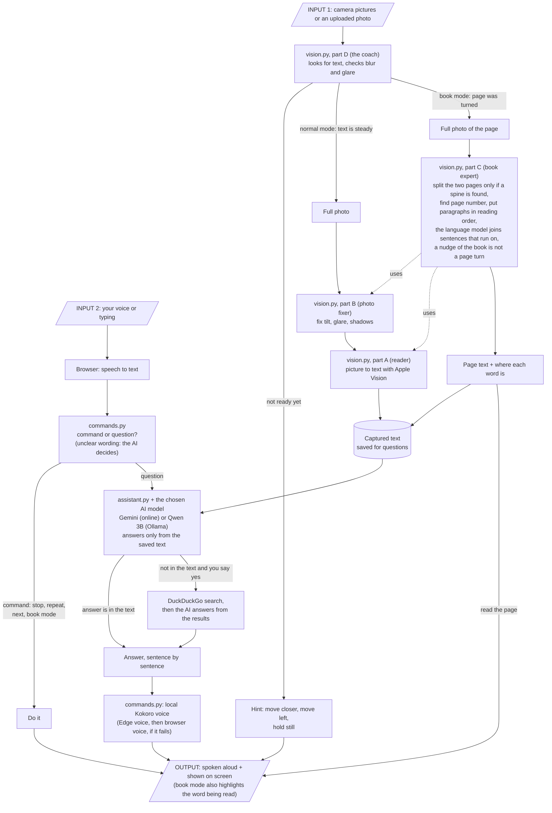

# How Helping Eyes works

Helping Eyes helps a person who cannot see well to read things like medicine boxes, letters and books.
You show the item to the camera. The app tells you how to hold it, takes a photo by itself, and then you
can ask questions like "When does it expire?" or just say "read everything".

It is **one app**. It has two parts:

- **The browser page** (what you see and hear): it uses the camera, the microphone and the speaker.
- **The server** (the brain): it finds the text in the picture, understands what you asked, and writes the answer.

The app runs on your own Mac. With `python run.py --share` it also gets a public address, so other people can use it while your Mac is awake.

---

## What each file does

### The brain (`helping_eyes/`)

| File | What it does, in simple words |
|---|---|
| `server.py` | The front desk of the server. It receives camera pictures, photos and questions from the browser and sends back guidance and answers. It tells the browser to check the page and its files on every load, so an old copy of the page is never mixed with a new script. It also remembers each person's item and conversation for 30 minutes. |
| `vision.py` | All the computer vision (looking at pictures), in four parts, so it is easy to find: **Part A, the reader:** turns a picture into text (OCR) with Apple Vision (built into macOS), which runs on this Mac. It can also quickly check whether any text is in view. **Part B, the photo fixer:** measures blur, glare and darkness, straightens a tilted page, flattens a curved page and brightens shadows, so the reader gets a cleaner picture. **Part C, the book expert:** finds the middle of an open book, splits the two pages, finds page numbers and titles, puts paragraphs in the right reading order (then the language model joins sentences that run over a line, column or page, and reads a sidebar or box after the main text instead of line by line across it), copes with a page photographed at a slant (it measures the slant, straightens the page to work out lines and paragraphs, and draws boxes that lean with the text), and keeps your place if the book moves a little. **Part D, the coach:** looks at the live camera pictures and decides "move closer", "move left", "too blurry", "hold still" and "now take the photo". In book mode it notices when you turn a page and decides what to read next. |
| `commands.py` | The listener and the voice. It decides if what you said is a command ("stop", "next", "book mode", "yes", "no", "look it up") or a question for the AI. Clear wordings are matched directly; when the wording is unclear (for example a different way of saying "yes, search the web"), the AI is asked what you meant, so any wording that means "look it up" works. It also turns each sentence into spoken audio: first with the free Kokoro voice that runs on this Mac (set up once with `python run.py --get-voice`), speaking as Sarah, an American female voice, and with a free Microsoft Edge voice (Jenny, female) if that is missing or fails, and spells out long numbers (above 9999) digit by digit, because they are serial numbers. |
| `assistant.py` | The answerer. It keeps the text that was captured and talks to an AI chat model: Gemini over the internet by default (any provider with an OpenAI-style API works) or Qwen 3B running on your Mac through Ollama, whichever you pick in the page's **Answers from** menu. It only answers from the captured text. It works out expiry dates itself, because small AI models get dates wrong. It can search the web, but only if you say yes. It also reads unclear "yes / no / search" wording. |
| `voice_models/` | The Kokoro voice model files (about 350 MB). `python run.py --get-voice` downloads them once; they are not kept in git. |
| `.env` | Your settings, in the one settings file: your AI key (the only required setting) and optional choices such as the model, the voice and the ngrok address, each listed as a comment. It is never put in git. |

### The face (`helping_eyes/web/`)

| File | What it does |
|---|---|
| `index.html` | The page layout: a top bar with **Settings** (let your screen reader read everything instead of the app's voice; switch the one-letter shortcuts off), the camera picture with its round shutter button (takes the photo now), the buttons, the **Answers from** menu (Online AI = Gemini, Offline AI on this computer = Qwen), a folded **What can I say?** list of voice commands, and the answer area. |
| `app.js` | The ears, mouth and eyes in the browser. It opens the camera and asks for the microphone permission in the same request as soon as the page opens, sends pictures to the server, plays the spoken hints and answers (the server's voice, with the browser's own voice as a backup), listens to your voice, and draws the boxes and the highlighted word on top of the camera picture. An uploaded photo is shown in its place, with the same boxes, the sharpness, light and glare figures, and (in book mode) the same reading highlight. It makes no decisions itself; it does what the server says. |
| `style.css` | How the page looks: a calm light and dark design with a slim see-through top bar, rounded cards, pill-shaped buttons and large answer text. Every colour pair was measured (the answer and body text at least 7 to 1 contrast, everything else at least 4.5 to 1), the focus ring is always thick and visible, buttons that are switched on (Listen, Book mode) are filled and show a check mark, and buttons are at least 48 px tall on a phone and 44 px on a laptop. It follows the computer's settings for reduced motion, more contrast, less transparency and Windows High Contrast. On a laptop screen everything fits the window with no scrolling. |
| `favicon.svg` | The small icon in the browser tab. |

### The checkers (`helping_eyes/tests/`)

There is one test file for each part of `vision.py`, plus one each for the other modules. They use made-up pictures and a fake AI server, so none of them needs a camera, an API key or internet.

| File | What it checks |
|---|---|
| `test_vision_ocr.py` | Part A (the reader): that text in a picture is read in the right order, that boxes and word positions are right, that blank pictures give nothing, and that a slanted page is measured, keeps its paragraphs and gets boxes that lean with the text. |
| `test_vision_quality.py` | Part B (the photo fixer): tilt, curve, blur, glare and darkness on made-up pages. |
| `test_vision_book.py` | Part C (the book expert): page numbers, headers and footers, reading order of columns and paragraphs, finding the middle of a book, noticing page turns, and keeping your place when the book moves. |
| `test_vision_live.py` | Part D (the coach): hints, hold-still timing, capture, and the book-page decisions, including the AI's paragraphs (a sidebar is its own block and is read after the main text, a sentence that runs over a column or page is one paragraph, and if the AI cannot answer the page is read as laid out). |
| `test_commands.py` | That "stop", "next", "yes", "book mode" and similar are understood correctly, in many wordings, and that unclear wording is left to the AI. Also the voice: the local voice speaks first, Edge is the backup, long text is spoken in pieces with nothing dropped, and the audio is real MP3. |
| `test_llm.py` | The AI client against a pretend AI server: the Gemini / Qwen choice picks the right model, sentences arrive one by one, errors are spoken plainly, the web-search offer works, and expiry questions never call the AI. The expiry dates are found in the usual label wordings (`Exp. Date 02/2027`, `Exp.Date:02/2027`, `Exp Dt. 02/27`, `Best before ...`). Also that the AI's grouping of a book page's lines is accepted only when no line is lost or doubled. |
| `test_server.py` | The whole server for real: reading a picture of a label, answering, the live stream, book pages, and the voice endpoint (which voice is first is shown in the health check). |
| `test_run.py` | The start button: that it finds the packages and the key (and that the key really reaches the server), picks a free port, really starts the app, serves the page, and stops cleanly. The local voice is optional and reported in one line. |
| `test_web_mic.py` | The microphone side of the web page, opened in a hidden Chrome with a pretend speech engine: words show while you speak, the finished sentence is sent, silence just listens again, and a missing or blocked microphone, or an unreachable speech service, is explained out loud and on screen. Also the page's start-up and voice side: camera and microphone are asked for in one request, the camera still starts without a microphone, a phone that blocks sound does not freeze the camera or the microphone, and a voice request that never answers is replaced by a second one. Skipped if Chrome is not installed. |

To run them all: `cd helping_eyes` and then `for t in tests/test_*.py; do python "$t" || break; done`. The evaluation's scoring rules have their own check: `python eval/test_scoring.py` from the top folder.

### Everything else

| File or folder | What it does |
|---|---|
| `README.md` | The full project report: problem, design, how to run it, results, limits. It is the only `.md` file in the top folder, so GitHub shows it on the project's front page. |
| `markdown/` | Every other guide, in one folder: |
| `markdown/working.md` | This file. |
| `markdown/direction.md` | What each button does and what you can say or type. |
| `markdown/hosting.md` | A plain-language guide to hosting the app from your Mac: setup, the `--share` command, the settings and what to expect. |
| `markdown/computer_vision.md` | Every computer vision idea of the project (pixels, maths, each step) in simple words. |
| `markdown/eval_plan.md`, `markdown/eval_shotlist.md` | The plan for testing the app on real photos (with the decisions taken along the way), and the list of photos to take for it. |
| `markdown/eval_results.md` | **All the test results in one place**, with each target from the course requirements marked met or not met. It is written by `eval/make_results.py`; never edit it by hand. |
| `markdown/resume_bullets.md` | Ready-made resume bullets about the project. Every number in them comes from `eval_results.md`, and it lists what did not work too, so you are ready for questions. |
| `markdown/user_study.md` | How to run the user study (5 or more people, about 15 minutes each) and where to write the results (`eval/data/user_study.csv`). |
| `eval/tools/` | The evaluation helpers: a photo intake page (`collect.py`), a folder import (`import_folder.py`) and photo checks (`check_photos.py`). The photos themselves go in `eval/data/private/`, which is never put in git. |
| `eval/run_photo_eval.py`, `eval/photo_report.py` | The photo test: every photo is read by Apple Vision (the app's reader), RapidOCR and Tesseract; the app's image checks (blur, glare, darkness, slant, package outline) are drawn on it as coloured boxes; every question is asked to the local Qwen model through the app's own code; and the results are compared with Claude's own reading of each photo. |
| `eval/make_check_folders.py` | Sorts the photos by image check into `eval/data/private/cv_checks/`: `blur_photos`, `glare_photos`, `dark_photos`, `slant_photos` and `outline_photos`. Each folder holds only the photos where that check found something, with only that check's boxes drawn, a one-line caption under the photo, and an `index.csv` listing them. |
| `eval/common.py` | Shared helpers for the tests below: it fixes "today" at 19 October 2026 so answers about expiry never change with the calendar, asks a question exactly the way the app does, retries when Gemini is busy (or when a reply has not finished after 90 seconds), and works out confidence ranges. |
| `eval/run_qa.py` | Gemini against Qwen: the same questions about the same photos to both models, scored by the same rules. It also checks the web lookup's safety (answers start with "According to the web", health answers end with the pharmacist reminder, no lookup is offered for expiry, batch or price), and makes a blind sample of free-text answers for judging by hand. |
| `eval/run_expiry.py` | 22 made-up label texts in the date formats of real packs: is "Has it expired?" answered right? Also what happens without the app's own date check (the model alone, once with the app's prompt and once with a neutral expiry rule, since the app's rule leans towards "not expired"), which shows why the app works dates out itself. |
| `eval/run_latency.py` | The speed test: starts the real server and times live frames, captures, book pages, answers and the voice, 20 times each. |
| `eval/run_book.py` | Book mode on real book photos (page numbers, running title, reading order) and on a real video of page turns. |
| `eval/make_results.py` | Collects every result file into `markdown/eval_results.md`. |
| `eval/test_scoring.py` | Checks the scoring rules themselves (dates, "not in the text", batch codes, yes/no, reading order), so a wrong rule cannot quietly change a result. |
| `eval/results/` | The results as numbers (JSON). No photo text is in them, so they can go in git. |
| `markdown/eval_photo_summary.md`, `markdown/eval_photo_report.md` | The photo test's results: the summary has only the numbers; the report shows every photo with its boxes, the text each reader found and every answer (it holds the photos' text, so it is not put in git). |
| `run.py` | The start button for your own laptop. One command, `python run.py`, starts everything: it checks that Python and the packages are fine, tells you if your AI key is missing, starts Ollama if it is installed and not already running, loads the Qwen model into memory (for the Qwen choice), starts the server, waits until the text reader has loaded, and opens the app in Chrome. Chrome does the camera, the microphone and listening. With `python run.py --share` it also opens a free tunnel and prints a public address for other devices: the same fixed address every time with ngrok (set `NGROK_DOMAIN`), or a new Cloudflare address each run. It picks another port if the usual one is busy, and stops cleanly with Ctrl+C. |
| `requirements.txt` | The one shopping list of Python packages for the whole project: running the app, the tests and the evaluation all use it. Install with `pip install -r requirements.txt` from the top folder. |
| `architecture.png` | The picture of a request's life cycle shown in the README. It is a finished image: the script that drew it is no longer in the project, so a change to the architecture means editing the picture by hand or redrawing it. |
| `presentation/` | The slides, the narrated video, the script and the course requirements document: the original template copy and `CS3235_Project_Requirements_v0.3.docx`, which matches the current app (hosting on the Mac as a justified change, still to be approved by the mentor) and points to the results. The slides and video still show an older design. |
| `.github/workflows/check.yml` | Makes GitHub run all the tests, and the check of the evaluation's scoring rules, automatically whenever code is pushed. |
| `graphify-out/` | A map of the code made by a helper tool (graphify). Not part of the app, and ignored by git, so it is never committed. |
| `.gitignore` | Tells git which files to ignore: your private `.env`, the `.venv` folder, `__pycache__`, `graphify-out/`, the voice model files, the private evaluation photos, the full photo report (`markdown/eval_photo_report.md`, which holds the photos' text) and macOS `.DS_Store` files. |

---

## The life cycle: from input to output

### The same life cycle in words

1. **Input:** the camera sends small pictures all the time (or you upload a photo, which is shown in place of the camera), and you speak or type.
2. **Coaching:** The coach (`vision.py`, part D) looks at each picture. If the text is not ready, you hear a hint ("Move closer" only when the text is small and the reader is not sure of it; small text that is read well needs no hint, and neither does an item that already fills 75 % of the picture; the item is found by growing it out from its own text, so a light floor or table around it is not counted). The round shutter button on the camera picture takes the photo at once; the photo then stays on the screen and the camera is off until you press New item or say "next". When it is steady, a full photo is taken. In book mode, a full photo is taken each time a page was turned.
3. **Getting the text:**
   - A normal photo is cleaned by the photo fixer (`vision.py`, part B), then read by the reader (`vision.py`, part A), and the text is saved.
   - A book photo goes through the book expert (`vision.py`, part C), which splits the pages, finds the page number and puts the paragraphs in order (using the photo fixer and the reader). Before a new page is spoken, the language model is asked which lines belong to the same paragraph, so a sentence that runs over a line, column or page is read without a pause; if it cannot answer, the page is read as laid out. The page is read out straight away and also saved.
4. **Understanding you:** your voice becomes text in the browser. `commands.py` decides if it is a command ("stop", "next") or a question.
5. **Answering:** commands are just done. Questions go to `assistant.py`, which asks the AI chat model to answer using only the saved text. If the text does not have the answer, it offers a web search and searches only if you say yes.
6. **Output:** everything comes back to the browser, which shows it on screen and plays it aloud. The server turns each sentence into audio with the local Kokoro voice (a second or two per sentence, with the next sentences prepared while one plays; the free Edge voice is the backup); if both fail for a sentence, the browser's own voice speaks that sentence, and if a sound stalls the browser voice says the rest instead of skipping it. On a phone the sound starts after the first tap. While a book page is being read, the word being spoken is highlighted.
